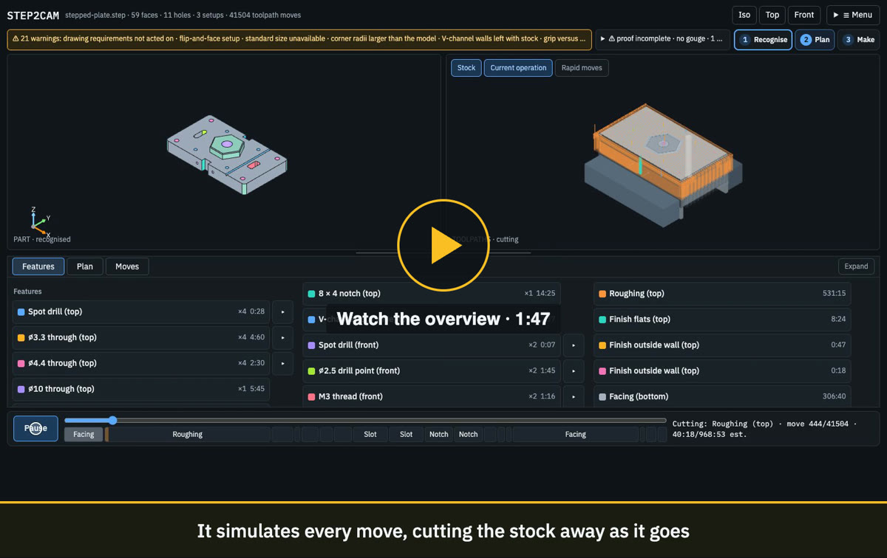

> [!CAUTION]
> **step2cam is an experiment, not CAM you can trust to run on a machine.** Its plans have not
> been checked by a machinist, and no program from it has been run on a real machine.
> Before running any G-code made from it: simulate the file in your own software, check every
> work offset, tool length and tool number against your setup, dry-run above the part, and
> single-block the first run with the overrides turned down. Apache-2.0, **no warranty**.

# step2cam

step2cam is an open-source experiment in automatic CAM planning for three-axis milling. It reads a
STEP part, finds what has to be machined, and drafts a process plan: the setups, the
workholding, the tools and the order of operations. Every choice names the written rule it was
made by. [camlib](https://github.com/stevecad/camlib) then turns the plan into toolpaths,
simulates them on the stock and checks them, and its posts write G-code for a real machine.

**Try it:** https://pzfreo.github.io/step2cam/ runs entirely in your browser; your file is not
uploaded.

[](https://pzfreo.github.io/step2cam/media/step2cam-overview.mp4)

The [overview video](https://pzfreo.github.io/step2cam/media/step2cam-overview.mp4) (1:47,
captioned, no sound) walks through it on the sample plate:
- the problem, and the GitHub page;
- the demo: feature recognition and the plan;
- camlib's simulation in the vise;
- the switch to the Haas and two of its G-code programs.

```
part.step ─▶ specify-core ─────────▶ capp (step2cam) ─────────▶ camlib
             features, mesh           setups, workholding,        toolpaths, stock simulation,
                                      tools, order, the trace     checks; G-code through its posts
```

- **[specify-core](https://github.com/pzfreo/specify-core)** recognises the features: holes,
  slots, counterbores, threads, flats and the part's shape.
- **capp** (`rust/capp`) plans them. Its rules are data with cited sources
  (`rust/capp/rulebase`), and each decision in the plan names one.
- **camlib** makes and checks the toolpaths. step2cam's adapter (`rust/src/job.rs`) turns each
  setup into a camlib job; an operation camlib refuses goes back to the planner and the plan is
  finished again without it.

It is written in Rust and runs natively or in the browser as WebAssembly.

## What it plans

For simple prismatic (2.5D) parts:

| Feature | How it is cut (camlib operation) |
| --- | --- |
| Stock top | Facing, after choosing a standard bar size |
| The part's shape | Roughing from the mesh, then flats at their exact heights and walls finished to size |
| Holes | Spot drilling and drilling (pecked when deep), or a helical bore when no drill fits |
| Counterbores | Helical bore |
| Threads (ISO metric, from Specify's answers) | Rigid tapping, or thread milling |
| Closed slots, notches, V-channels | Pocket, or a trace with a V-bit |
| Top edge rounds | A 45° chamfer that meets the round |

Around those operations it plans:
- **Setups:** one per direction holes must be entered from, each with how its zero is
  picked up.
- **Workholding:** a vise, with parallels and a flip-and-face route. It checks contact on the
  jaws and the vise's grip against the cutting force.
- **Tools:** chosen from a JSON library. Anything missing is reported as a tool to buy, never
  guessed.

What it leaves out, and why, is in the plan.

## What it does not do

Real process planning is a much harder problem, and step2cam does not model most of what makes it
hard:

- **Tolerances and GD&T:** it warns of tolerances on the drawing rather than planning for them.
- **Cutting physics:** it does not model deflection, chatter, chip evacuation or thin walls.
  Its feeds and speeds are starting data from the machine maker or tool catalogues, not
  calculated for your part.
- **Workholding:** it checks the vise's grip against the cut, but not how firmly the vise holds
  the part, or lift and turning moments.
- **Real parts:** interacting features, drafts and freeform shapes break its recognition and
  planning. The sample parts are friendly.
- **Not planned yet:** sloped walls, curved surfaces and pocket walls; countersinks; removing
  the roughing web; 4/5-axis; lathe work ([full list](docs/plan-format.md#not-done-yet)).

camlib's checks show the toolpaths stay clear of the part. They don't show that the part will be
good: its finish, accuracy and burrs, or whether it survives being cut.

**Feedback is the point.** Because every decision names its rule, "rule X is wrong here,
because…" is the most useful report: [open an issue](https://github.com/pzfreo/step2cam/issues).

## The demo

https://pzfreo.github.io/step2cam/ shows the work in three panes:
1. what the part is: the features specify-core recognised;
2. how to make it: the plan, with the rule behind each decision;
3. making it: camlib's toolpaths, played on the stock in its vise, setup by setup.

Hovering over any feature, operation or move highlights the same thing in all three panes.

Open your own STEP file, or one of the sample plates. The Machine menu picks one of three:
- the Makera Carvera (the default);
- a Haas VF-2;
- a generic LinuxCNC mill.

Each one replans the part with that machine's tools. Their sources and assumptions are in
[libraries/README.md](libraries/README.md).

What you can save:
- **Save plan:** the plan as JSON, with its full trace.
- **Save camlib job:** each setup as a job for camlib's own posts.
- **Save G-code** (Haas only): camlib's Haas post writes the program, then reads it back and
  checks it against the plan. The page downloads it only if camlib releases it.
  - On the sample plates, the bottom setups and the complex plate's front setup release.
  - The top setups are refused, because camlib cannot yet prove their drill plunges clear of
    the part.
  - The controller and setup premises the program assumes are listed beside it: check them
    against your control. [Haas posting details](libraries/README.md#haas-posting).
  - Carvera G-code waits for a measured spindle-to-bed height.

## Use without a browser

```bash
rust/fetch-camlib.sh    # camlib at the pinned commit
specify-core analyse -o analysis.json part.step
specify-core mesh -o mesh.json part.step
cargo run --release --manifest-path rust/Cargo.toml --example process -- analysis.json mesh.json examples/tools.example.json
```

This prints the plan, each setup's camlib job and its moves, and the log as JSON. To post a saved
job with another camlib post (LinuxCNC, GRBL, FANUC, Siemens, Centroid and others):

```bash
python examples/post_with_camlib.py plate-top.camlib-job.json plate-top.nc
```

Build the demo locally:

```bash
demo/build.sh && python3 -m http.server -d site 8790   # needs Rust, wasm32-unknown-unknown and wasm-pack
```

## Reference

- [The plan format](docs/plan-format.md) (`specify-cam-plan` v1): stock, setups and zeros,
  operations, threads, hole depths, the trace, and what is skipped and why.
- [The tool library](docs/tool-library.md): tool fields (with ISO 13399 names), machines,
  vises and parallels, library settings, and which tool each operation gets.
- [Library sources and assumptions](libraries/README.md): the Carvera, Haas and LinuxCNC
  libraries.
- [Planning design and limits](docs/capp-plan.md): rules, workholding, pickups, grip against
  the cut.
- [Safety and what the checks cover](docs/plan-format.md#safety).
- [ROADMAP.md](ROADMAP.md): what comes next. [docs/upstream-needs.md](docs/upstream-needs.md):
  what step2cam needs from specify-core.

## Development

```bash
rust/fetch-camlib.sh
cargo test --release --workspace --manifest-path rust/Cargo.toml
npm ci --ignore-scripts && node tests/report.mjs && node tests/post.mjs
```

[docs/plan-format.md#tests](docs/plan-format.md#tests) says what each suite covers. The hand-run
100-part benchmark is in [tools/benchmark](tools/benchmark/README.md). How AI agents work on this
project is in [docs/agents.md](docs/agents.md).

## License

[Apache-2.0](LICENSE). specify-core is Apache-2.0; camlib is MIT. This project imports both
and includes neither; the demo site's WebAssembly contains both.
